# Nonlinear RF Circuits in Keysight ADS (Homework 3)

The third practical assignment of the Communication Circuits course covers nonlinear circuits:
- BJT large-signal transconductance and harmonic distortion (harmonic balance)
- the transfer curve of an emitter-degenerated differential pair
- an LC oscillator
- AM modulation and envelope detection

Every key number is checked independently in Python ([`python/verify.py`](python/verify.py)).

> **Course:** Communication Circuits (Prof. A. Abdipour), Amirkabir University of Technology, Fall 2025.

## Results at a glance

| Q | Quantity | ADS | Python check |
|---|---|---|---|
| 1 | THD of the collector current, v_in = 1 mV | 0.973 % (written as "97.3 %" in the original report) | **0.973 %** (Bessel theory, ≈ x/4) |
| 1 | 2nd-harmonic level at 1 mV | ≈ −40 dBc | −40.2 dBc |
| 1 | Input level where THD reaches 100 % | THD peaks at ≈ 0.17 V | 168 mV (ideal device) |
| 2 | Linear input range, R_E = 0 / 250 / 500 Ω | plots | ±15 / ±190 / ±415 mV (gain 194 / 33 / 18 V/V) |
| 5 | Envelope-detector ripple, τ = RC = 50 ns | 0.359 V | 0.358 V |

## Q1: Large-signal transconductance and distortion (harmonic balance)
**Setup.** A BJT biased at V_BE = 0.78 V is driven by a 1 GHz tone. Harmonic balance (9 harmonics) gives the collector-current spectrum, from which THD and the large-signal transconductance G_m = I_fund / v_in are computed.

| Circuit | Spectrum at v_in = 1 mV | Sweep of v_in: spectrum, G_m, THD |
|---|---|---|
| 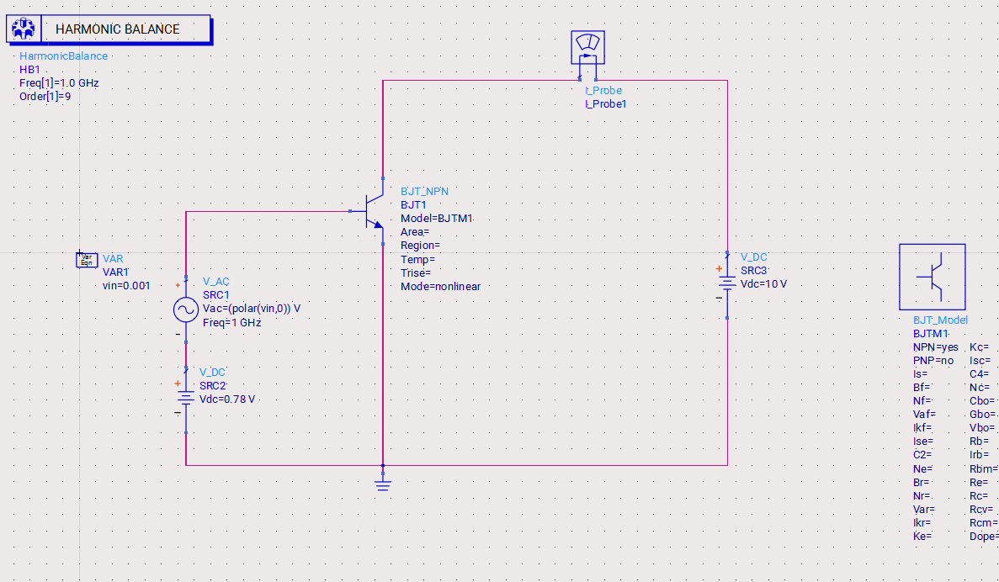 | 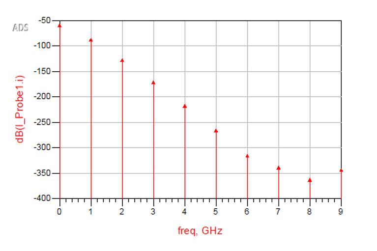 | 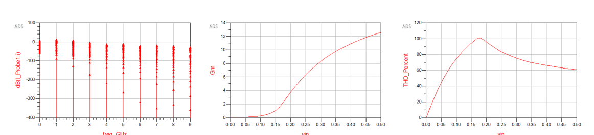 |

**Theory.** With $i_C = I_Q e^{x\cos\omega t}$ and $x = v_{in}/V_T$, the Fourier coefficients are modified Bessel functions:

$$i_C = I_Q\Big[I_0(x) + 2\sum_{n\ge1} I_n(x)\cos n\omega t\Big],\qquad \mathrm{THD}=\frac{\sqrt{\sum_{n\ge2}I_n^2(x)}}{I_1(x)}\approx\frac{x}{4}\ \ (x\ll1)$$

- **At 1 mV.** x = 0.039 (V_T = 25.7 mV at 25 °C) gives **THD = 0.973 %** and HD2 = −40 dBc, consistent with the spectrum. The original report wrote "97.3 %", a slip by a factor of 100.
- **Growth with amplitude.** THD rises with amplitude and passes 100 % at about 168 mV, which is where the ADS sweep peaks.
- **Beyond the peak.** The ADS curve then falls, because the transistor model's series resistances and high-injection effects compress the current, unlike an ideal exponential.
- **G_m.** Because the bias is a fixed V_BE (not a fixed current), the DC current also grows with the drive. So G_m *increases* with amplitude, as in the ADS sweep.

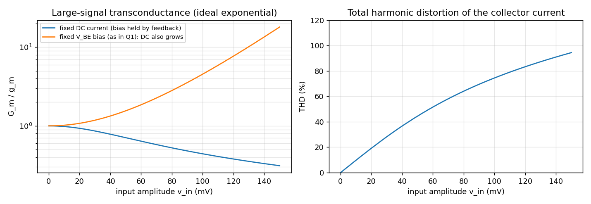

## Q2: Differential pair with emitter degeneration
With I_EE = 1 mA, R_C = 10 kΩ and R_E = 0, 250 and 500 Ω, the input loop gives

$$V_{id} = (V_{BE1}-V_{BE2}) + R_E(I_{E1}-I_{E2}) = V_T\ln\frac{I_1}{I_2} + R_E\,I_{EE}\tanh\frac{u}{2},\quad u=\ln\frac{I_1}{I_2}$$

- **Without degeneration.** The output is the classic $I_{EE}R_C\tanh(V_{id}/2V_T)$, which is linear only for about ±15 mV.
- **With degeneration.** The linear term R_E·ΔI widens the linear range to about ±190 mV (R_E = 250 Ω, I_EE·R_E = 10 V_T) and ±415 mV (500 Ω). The cost is that small-signal gain drops from 194 to 33 and 18 V/V.

| R_E = 0 | R_E = 250 Ω | R_E = 500 Ω | Python |
|---|---|---|---|
| 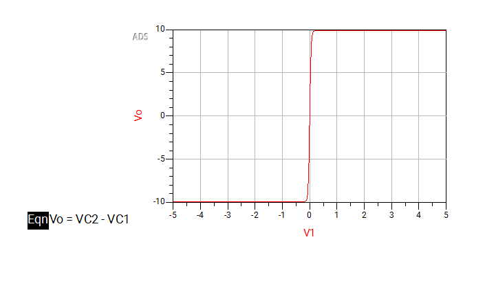 | 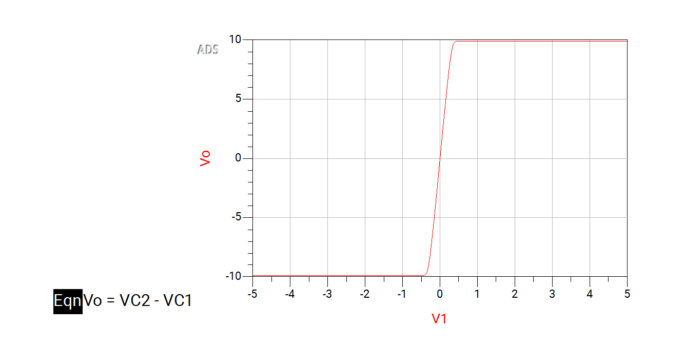 | 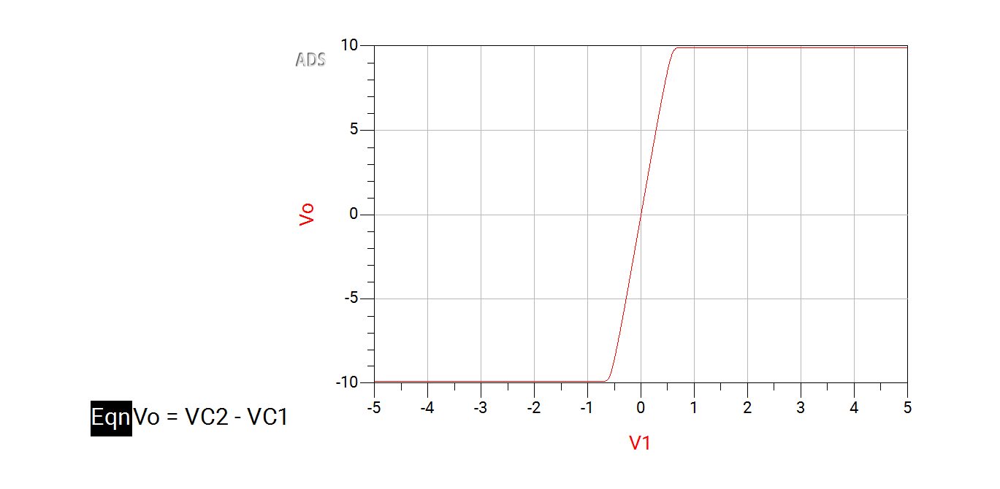 | 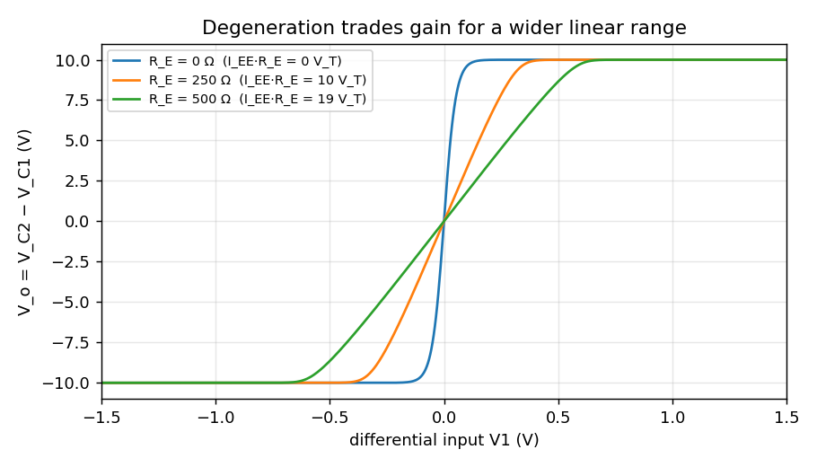 |

## Q3: Transformer-coupled LC oscillator
**Circuit.** The original report classifies it as an Armstrong (transformer-feedback) oscillator. Looking at the schematic, the feedback to the emitter is actually taken from the C4/C3 capacitive divider across the transformer winding, so it behaves like a common-base Colpitts oscillator with a transformer-coupled tank.

**Analysis.** Harmonic balance with an `OscPort` finds the steady-state oscillation. The output is dominated by the fundamental: the 2nd and 3rd harmonics are about 42 and 54 dB lower.

The harmonic axis in the original plot only shows the HB frequency grid (3 / 6 / 9 MHz). The actual oscillation frequency should be read from the OscPort result, which isn't in the original report.

| Schematic | Harmonic content |
|---|---|
| 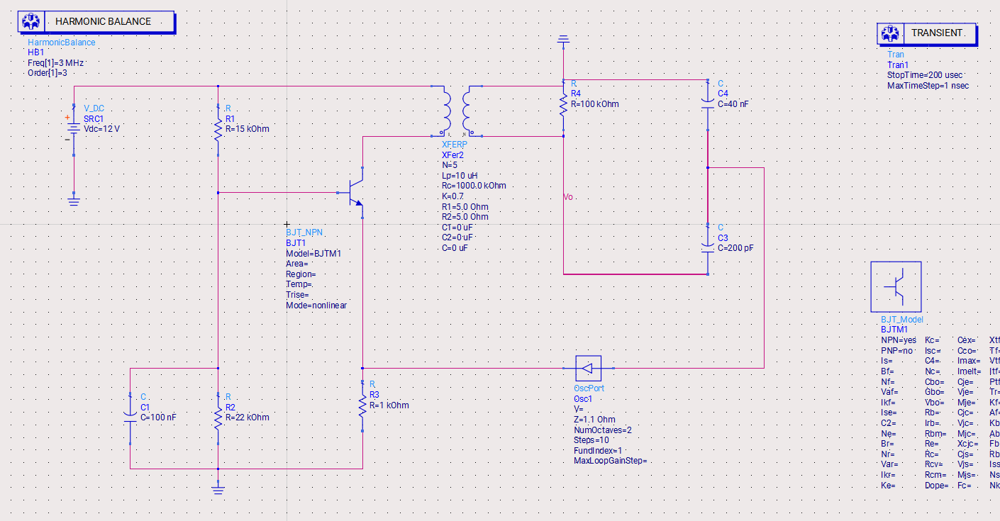 | 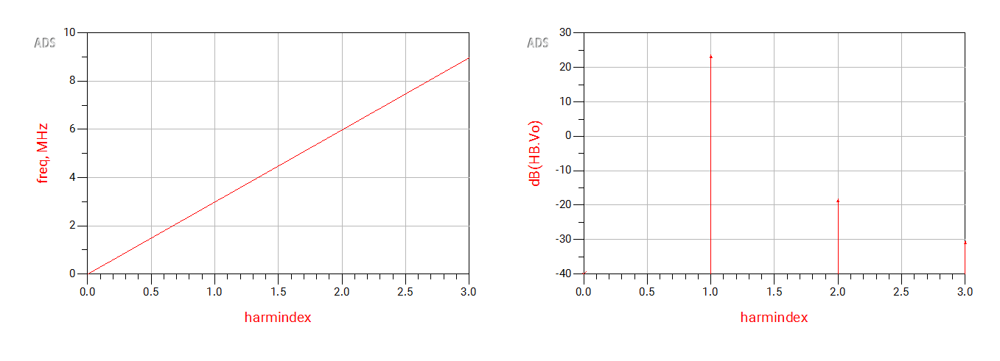 |

## Q4: AM modulation and envelope detection
A 5 kHz message (1 V) amplitude-modulates a 1 MHz carrier. An RLC band-pass tuned to 1 MHz removes the mixing products, and a diode envelope detector recovers the message.

| Modulated signal | Demodulated output |
|---|---|
| 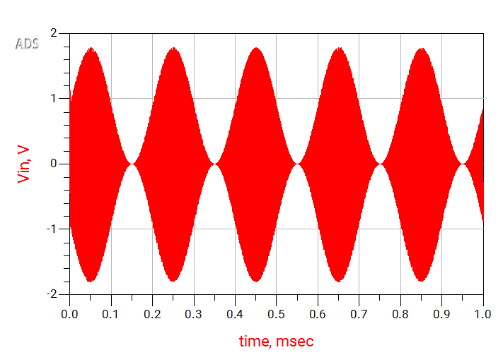 | 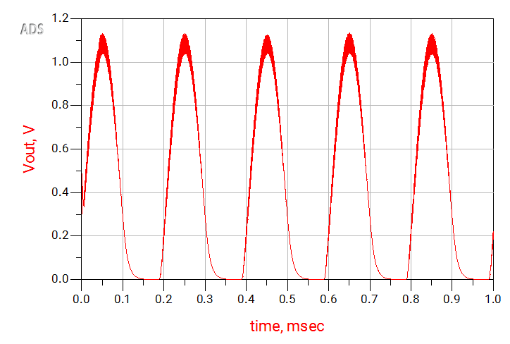 |

## Q5: Envelope-detector time constant
**Original detector.** With R = 500 Ω and C = 100 pF, τ = 50 ns, much **shorter** than the 1 µs carrier period. The capacitor discharges completely every cycle, so the output is simply a half-wave-rectified carrier with 0.36 V of ripple. A diode-equation simulation reproduces this (0.358 V vs. 0.359 V in ADS).

**Correct design rule.** For an AM envelope detector, $1/f_c \ll RC \ll 1/f_m$ (more precisely $RC < \sqrt{1-m^2}/(m\,\omega_m)$ to avoid diagonal clipping). Here, RC around 10–20 µs suppresses the 1 MHz ripple by more than 20 dB while still following a 5 kHz envelope. Part (b) was left unanswered in the original submission.

| ADS (τ = 50 ns) | Python: output and ripple vs. RC |
|---|---|
| 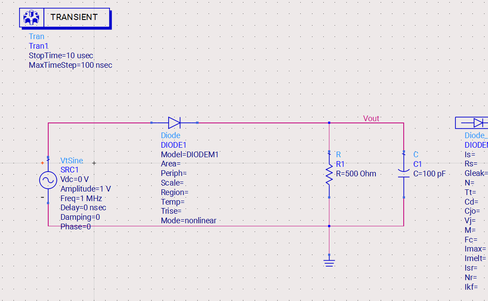 | 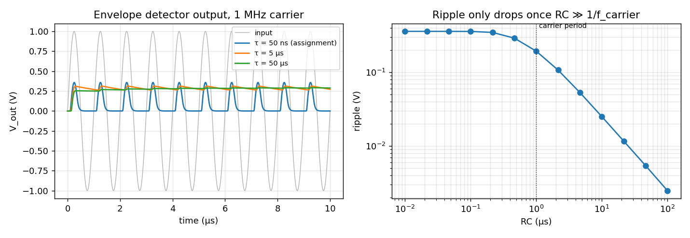 |

## Repository contents and running
```
ads/HW3_ADS_wrk/     ADS workspace (cells Q1-Q5, data displays)
python/verify.py     Bessel / transfer-curve / detector checks and the py_*.png figures
docs/                ADS screenshots (ads_*.png) and Python figures (py_*.png)
```
```bash
pip install numpy scipy matplotlib
cd python
python verify.py
```
The 367 MB transient dataset of Q3 is not included; ADS regenerates it when you re-run the cell.

## Skills
Harmonic-balance and transient simulation in Keysight ADS · nonlinear device analysis (Bessel-function distortion, large-signal G_m) · differential amplifiers · oscillators · AM modulation and detection · Python and SciPy

## Author
**Sepehr Ebrahimi**, B.Sc. Electrical Engineering, Amirkabir University of Technology (2026)
